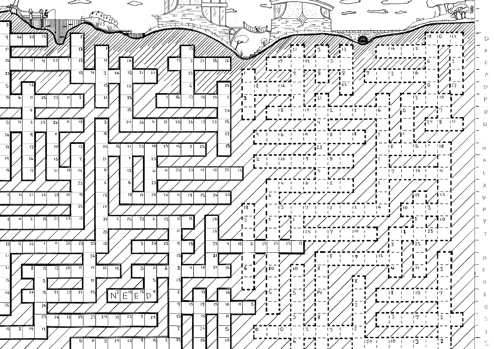

  
0:00

  <table class="key" id="keyTable" aria-label="Cipher key">
    
    <tr><th>&Omega;</th><th>C&sup1;</th><th class="c2h">C&sup2;</th></tr>
  </table>
  

    
  

<input id="kbd" type="text" autocomplete="off" style="position:fixed;opacity:0;pointer-events:none;bottom:0;left:0;height:1px;width:1px;">

