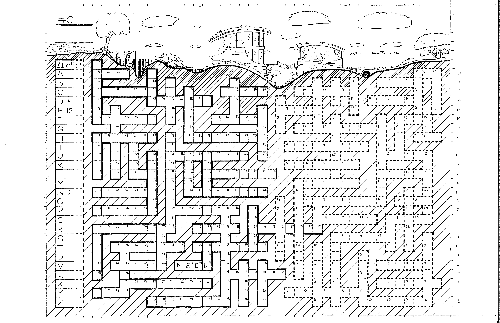

  <button id="btnZoomOut" type="button">Zoom &minus;</button>
  100%
  <button id="btnZoomIn" type="button">Zoom +</button>
  <button id="btnClear" type="button">Clear letters</button>

  

    
  

