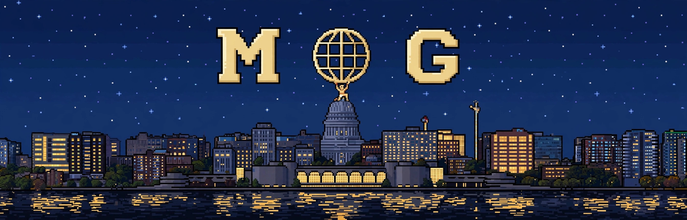
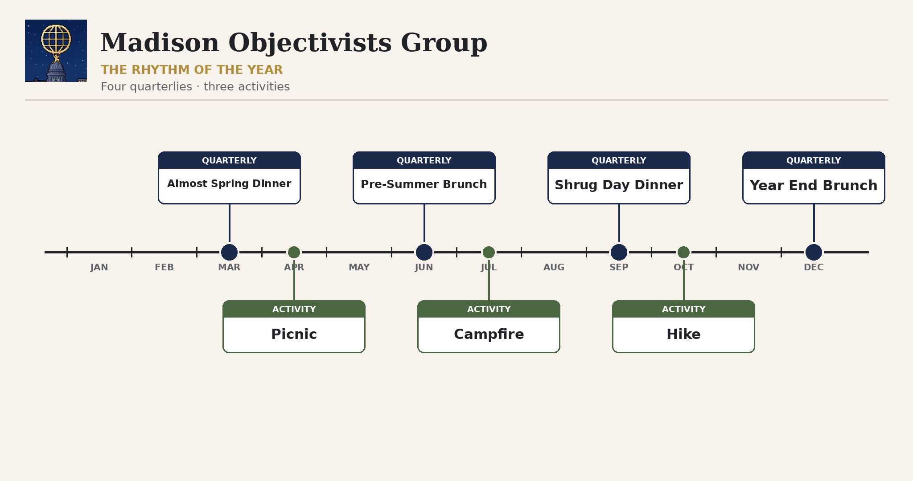

## Purpose

The purpose of Madison Objectivist group is to host enriching conversational meetings every 2-3 months with local Objectivists.

Not debate, not education, and not "outreach", just the occasional meeting with sane people. There is no online forum, but I do manage a digital storefront on various social media so as to make the group findable to objectivists living in or visiting Madison.

There is an RCS chat for posting meeting times and locations. Any outreach activities conducted by MOG or its members are secondary to the group's core purpose.

## Calendar

## Policies

- Membership is reserved for those who have a significant grasp of Objectivist philosophy, consider themselves Objectivists or students of Objectivism, and are reasonably successful in living according to the principles of rational self-interest.
- Membership is anonymous, and group photos are to be posted only inside the Facebook group and in the RCS chat unless specific approval to share publicly is granted by those in the photo.
- There are no dues.
- There is no quorum for gatherings. I just do my best to make them worth attending for the largest number possible, and I invite people I'd be comfortable chatting with even if it was just us two.
- Friends and significant others are welcome to attend events so long as they're thoughtful and trusted people, but only Objectivists are full members with group chat access.
- Events listed on the calendar are merely a consistent baseline. Members are welcome to invite each other out to chat at their own discretion, and are welcome to promote any Objectivism-related local activities to the RCS chat.

## Socials (If you're into that sort of thing)

[Facebook Page](https://facebook.com/1348463565021032/) · [Facebook Group](https://facebook.com/groups/1303359532868960/)
