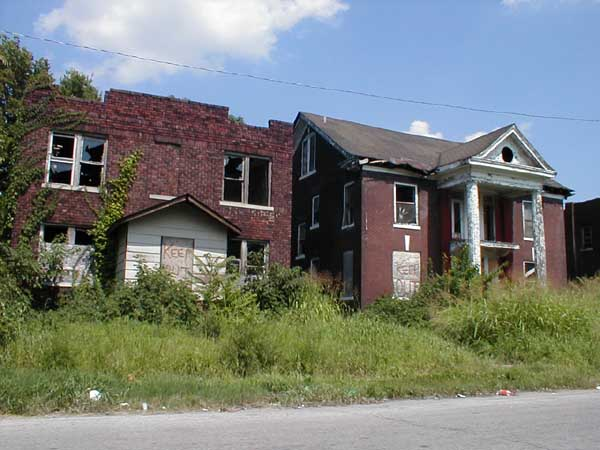

Is it the best of times or is it the worst of times? As a fan of freedom, reason, and the Enlightenment it can be surprisingly difficult to say. Here are my observations:

1. We are incomprehensibly safe, healthy, peaceful, rich, and knowledgeable compared to any prior point in human history.

2. Our unprecedented knowledge includes an unprecedented knowledge of the errors still remaining, and the work still to be done. Since we have gotten a taste of so much civilization, the gaps have become glaring: the majority of citizens in the Western world have the economic intuition of a child; the majority of art is hypnotic stimuli and or thoughtless simulacra; the majority of education is rote busywork. True genius of the kind that built modernity seems vanishingly rare, meanwhile millions of people don't know how to make themselves useful in the economy, and "truth" is so distorted that people either return to skepticism or call the world "post-truth".

3. It has been common to hear people smother the second fact with the first and appeal to gratitude. This "stop whining" refrain, however popular, is myopic and counter-productive in its lack of vision of a 4th fact.

4. The world can be much, much better than it is today. Backward religions can be reduced to a footnote in history books. People can trade with each other as respected intellectuals and simultaneously enjoy sex and intimacy. Businesses and institutions and entrepreneurial ventures can succeed or fail without calls to institute tyranny and controls. People can disagree and evaluate knowledge without unnecessary censorship or wrath and shame.

5. The more vividly I have understood my own potential to understand and improve the world, the more my attitude has resembled neither sedate satisfaction nor helpless, frustrated panic, but a secret, rare third thing: joyous defiance. I greet the world like a doctor stretching on blue medical gloves and saying confidently: "Let's see the patient."
