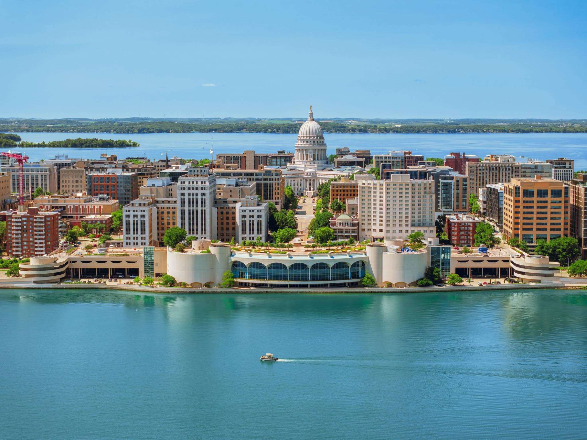

<!--more-->

Stub — points to write up:

- Madison is the land of Wright.
- It's part of the Great Lakes watershed, with lots of fertile land.
- It's a college town with no rotted-out industrial area like the rest of the Rust Belt.
- It has constant international cultural infusion through the university system.
- The benefits of having a winter, as in the fable about the hen that has to store up seeds for winter.
