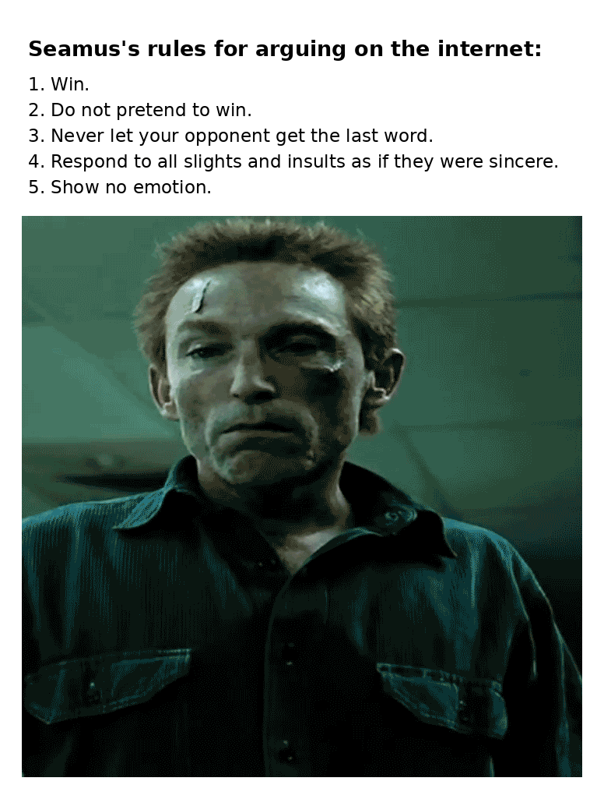

Facts matter. In fact, they're the only thing that matters. Facts and matter are both absolutes, thus "The facts of the matter" are synonymous with "the matters at hand". It is terribly bad for one's mind to make a habit of "agreeing to disagree" or living in vagueness. Note: this is not to say that all matters have to be sorted immediately with all persons around regardless of context. The honest version of the statement "let's agree to disagree" is "We do not have the time or expertise to settle this matter at present."

<!--more-->

In the event that one has decided to engage with another on the subject of a matter, the venture must be worthwhile. Hissy fits, dunks, ad-hom, and the like are completely counterproductive to the proliferation of truth, but nevertheless people are prone to start "arguments" which are a mixture of truth-seeking and insult-flinging. In the event that someone has chosen this childish behavior, it's best to intellectually humiliate them by winning the argument, and thereby strike a blow for the pursuit of truth. My rules for doing so are outlined in this gif.

Note that sometimes winning means admitting you were wrong. That is why the second rule is not to falsely purport to have won. It might seem silly that these are the first two rules, but in my defense: note that these are essentially the first two rules in a courtroom setting as well. Wringing truth from an argument requires that both parties seek first and foremost to win.
